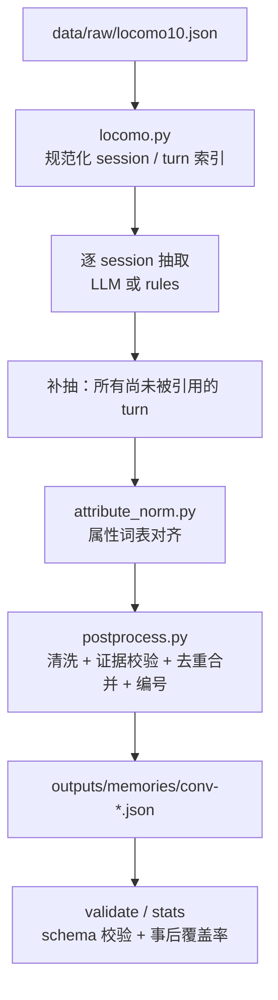

# LoCoMo → Structured Memory（A2 数据/抽取）

本目录负责把 `data/raw/locomo10.json` 解析成符合 [`APIs/memory_schema.json`](../../APIs/memory_schema.json)
的 Memory JSON，产物写入 `outputs/memories/<sample_id>.json`。

- 输入：LoCoMo 的 `conversation`（全部 10 个样本、292 段 session、5882 轮对话）
- 输出：10 个 Memory JSON，共 4340 条 memory，每条都能追溯到具体 `dia_id`
- **抽取阶段完全不读取 `qa` 字段**：问题与答案只用于事后评估（`evaluation/`），
  否则就是把测试集信息带进产物。

## 1. 目录结构

| 文件 | 职责 |
|---|---|
| `locomo.py` | 解析原始 JSON：session 排序、日期解析、`dia_id` 索引、observation 规范化、相对时间解析 |
| `prompts.py` | 抽取提示词（整段 session + 补抽），定义字段含义与输出 JSON |
| `llm.py` | OpenAI 兼容客户端（DeepSeek / OpenAI），带重试与 JSON 解析 |
| `cache.py` | 按提示词 SHA-1 缓存 LLM 响应，重跑零调用、可复现 |
| `rules.py` | 离线基线：用数据集自带 `observation` 标注生成记忆，零 API 依赖 |
| `attribute_norm.py` | 每个样本一次的词表对齐，统一同名不同写法的 `attribute` |
| `postprocess.py` | 字段清洗、证据校验、去重合并、排序编号、schema 校验 |
| `pipeline.py` | 编排：session 抽取 → 补抽 → 归一 → 合并 → 落盘 |
| `cli.py` / `__main__.py` | 命令行入口 |

## 2. 数据流



## 3. 字段映射

| Memory 字段 | 来源 | 说明 |
|---|---|---|
| `memory_id` | 生成 | `mem-<sample><序号>`，如 `mem-conv30-001`，样本内唯一且稳定 |
| `subject` | 对话 | 只取发言人（`speaker_a` / `speaker_b`），不会出现代词或虚构人名 |
| `type` | LLM 判断 | `state / event / goal / preference / requirement`，非法值用规则从 content 兜底推断 |
| `content` | LLM 生成 | 一句完整英文陈述，包含主语姓名 |
| `attribute` | LLM 生成 + 词表对齐 | snake_case 维度名，可在同一样本内复用，如 `dance_studio.lifecycle_stage` |
| `value` | LLM 生成 | 该维度的具体取值，如 `searching_for_location`；`event` 可以为 `null` |
| `time.session_id` | 证据 turn 反推 | 由 `dia_id` 推导，不信任模型自报 |
| `time.date_time` | `session_N_date_time` | 保留原始字符串，如 `1:56 pm on 8 May, 2023` |
| `time.effective_at` | 解析 | 仅在能确定时给出 `YYYY-MM-DD`（`yesterday`、`last Saturday`、明确日期等），否则 `null` |
| `evidence[]` | 原始对话 | `session_id` + `dia_id` + `quote`（必须是原文连续子串，否则置 `null`） |
| `confidence` | LLM 自评 | 截断到 `[0, 1]`，规则模式固定 0.75 |

`content` 用英文书写：LoCoMo 的对话和问题都是英文，B 的检索与 LLM 判断在同一语言空间里效果更好。

## 4. 抽取策略

### 4.1 逐 session 抽取

每段 session 单独请求一次 LLM，输入包含：

- 两个说话人、session id、session 日期（原始串 + `YYYY-MM-DD`）
- 数据集自带的人工 `observation` 标注（作为线索，不强制采信）
- 该 session 的全部对话 turn（含 `dia_id`，图片 turn 附带 caption）

同时要求模型给出 `evidence` 的**逐字引用**，因此幻觉的代价会被后处理直接暴露。

### 4.2 补抽（无 QA 依赖）

第一轮只覆盖“被明确抽成记忆的 turn”，仍有大量事实落在其它 turn 上。补抽阶段选取
**所有没有被任何 memory 引用的对话 turn**（跳过长度 < 20 字符的寒暄），按 6 个一批、
带 ±2 轮上下文再抽一次。

> 这里刻意不使用 `qa.evidence` 来挑选 turn。测试时问题是未知的，用 evidence 选 turn
> 等于用测试集答案指导抽取。

### 4.3 离线基线

`--provider rules` 不做任何 API 调用：把 `observation` 的 (句子, dia_id) 直接转成 memory，
用关键词判断 type / attribute，`value` 由句子压缩成 slug。它保证流水线在无网络、无密钥时
依然可跑通，也是回归测试的确定性基准。

## 5. 清洗与合并规则

1. **证据校验**：`dia_id` 必须存在于该样本；`session_id` 由 `dia_id` 反推；
   `quote` 必须是该 turn 原文（或图片 caption）的连续子串，否则置 `null`（保留 `dia_id`）。
2. **类型兜底**：非枚举 `type` 用规则推断，而不是丢掉整条记忆。
3. **属性兜底**：`event` 以外若缺 `attribute`/`value`，用内容关键词重建；过泛的属性名
   （`value`、`detail`、`fact` …）同样重建。
4. **词表对齐**：同一样本内把同义属性名合并（`pets` / `pet` / `pet_ownership`），
   由每个样本一次 LLM 调用完成；输出经过严格校验，非法映射直接忽略。
5. **状态合并**：`(subject, type, attribute, value)` 完全相同 → 合并为一条，保留首条时间、
   合并证据（最多 8 条）。若两次相同取值之间出现过不同取值（A→B→A），则不合并。
6. **事件合并**：同一 session、同一 `effective_at`、内容高度相似的事件合并。
7. **编号**：按第一个证据 turn 排序后重新编号，保证同一份数据多次生成结果稳定。

> 不自动合并语义相近但不同的 `value`（如 `owns_dance_studio` 与 `runs_dance_studio`）。
> 这类判断交给 B 的关系分类，硬合并会掩盖真实的状态变化。

## 6. 用法

依赖：`jsonschema`（校验）、`openai` + `python-dotenv`（LLM 模式）。
当前环境里 `openai` 装在仓库内虚拟环境：

```bash
python -m venv --system-site-packages .venv
.venv/bin/pip install openai python-dotenv
```

```bash
# 全量抽取（有 DEEPSEEK_API_KEY 时默认走 LLM）
.venv/bin/python -m backend.extract build

# 只跑某几个样本 / 离线基线
.venv/bin/python -m backend.extract build --samples conv-26,conv-30
.venv/bin/python -m backend.extract build --provider rules --out /tmp/memories

# 跳过已生成的样本，或不用缓存
.venv/bin/python -m backend.extract build --resume
.venv/bin/python -m backend.extract build --no-cache

# 关闭补抽 / 关闭词表对齐
.venv/bin/python -m backend.extract build --no-gap-fill
.venv/bin/python -m backend.extract build --no-attr-normalize

# 校验与统计
.venv/bin/python -m backend.extract validate
.venv/bin/python -m backend.extract stats
```

| 参数 | 默认值 | 说明 |
|---|---|---|
| `--provider` | `auto` | `auto` 有密钥走 LLM，否则退回 `rules` |
| `--workers` | 6 | 并发请求数 |
| `--gap-batch-size` / `--gap-context` | 6 / 2 | 补抽批量与上下文轮数 |
| `--cache-dir` | `.cache/extract` | 响应缓存（已 gitignore） |
| `--report` | `outputs/extraction_report.json` | 汇总报告 |

## 7. 当前产物

`python -m backend.extract stats` 的结果（DeepSeek `deepseek-flash`）：

| sample | memories | state | event | goal | preference | requirement | 被引用 turn | QA evidence 覆盖率* |
|---|---:|---:|---:|---:|---:|---:|---:|---:|
| conv-26 | 327 | 115 | 106 | 35 | 71 | 0 | 306 | 94.8% |
| conv-30 | 280 | 109 | 57 | 59 | 52 | 3 | 276 | 93.3% |
| conv-41 | 500 | 172 | 136 | 69 | 121 | 2 | 470 | 100.0% |
| conv-42 | 448 | 143 | 121 | 51 | 132 | 1 | 445 | 95.0% |
| conv-43 | 453 | 120 | 132 | 60 | 140 | 1 | 444 | 97.0% |
| conv-44 | 514 | 163 | 125 | 88 | 133 | 5 | 497 | 97.6% |
| conv-47 | 484 | 153 | 151 | 60 | 118 | 2 | 478 | 99.2% |
| conv-48 | 483 | 166 | 132 | 46 | 138 | 1 | 445 | 98.2% |
| conv-49 | 405 | 145 | 90 | 65 | 102 | 3 | 374 | 91.2% |
| conv-50 | 446 | 140 | 131 | 73 | 102 | 0 | 408 | 98.5% |
| **合计** | **4340** | **1426** | **1181** | **606** | **1109** | **18** | **4143** | **96.4%** |

\* QA evidence 覆盖率 = 该样本 QA 标注的 evidence turn 中，至少被一条 memory 引用的比例。
**这是事后评估指标，不参与抽取**；它同时是 `evaluation/build_cases.py` 生成 Recall@K 用例的基础。

全部 10 个文件均通过 `memory_schema.json` 校验，且未出现 `memory_id` 重复、
`dia_id` 不存在、`session_id` 与 `dia_id` 不一致的情况。

## 8. 已知限制

- **`value` 未做语义级合并**：同一个状态的不同措辞会保留为两条（例如
  `owns_dance_studio` / `runs_dance_studio`），交给 B 的关系判断处理。
- **属性词表仍有长尾**：每个样本约 40–70 个属性，少量只出现一次；`favorite_activity`
  与 `hobby` 这类近义维度仍然并存。
- **`effective_at` 覆盖有限**：只有 200 余条能确定到具体日期，其余为 `null`，
  B 需要用 `session_id` 的 `date_time` 做时间排序。
- **补抽会增加成本**：一次全量约 970 次模型调用（292 次 session 抽取 + 约 670 次补抽 +
  10 次词表归一），单样本约 20 秒；重复执行会命中缓存，不再计费。
- **事件类 `attribute` 常为 `null`**（schema 允许），事件之间靠内容与时间对齐。

## 9. 与 B 的约定

- 读取方式：`MemoryStore("outputs/memories")`（或设置 `DMS_MEMORY_DIR`），字段与
  `backend/schemas.py::Memory` 完全一致。
- 一条 memory 的 `evidence` 至少 1 条，`quote` 可能为 `null`；前端展示时用 `dia_id`
  回查原始对话即可。
- `attribute` 是状态比较的槽位：相同 `subject` + `attribute` 的不同 `value` 才表示状态演进；
  `event` 的 `attribute` 可能为空，不应参与槽位比较。
