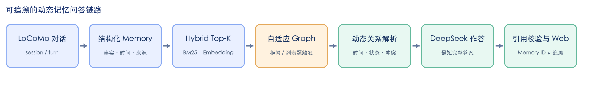
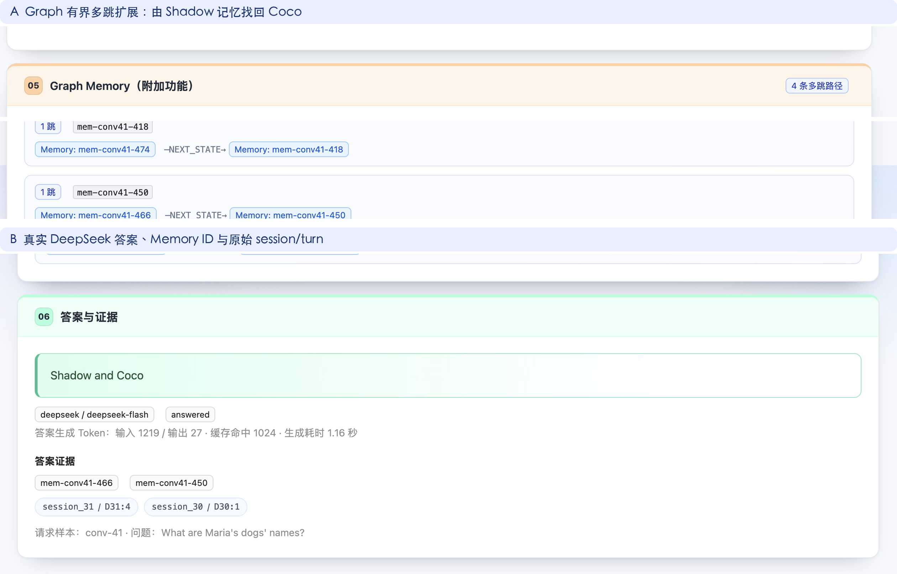

# 智能体动态记忆管理系统：最终报告

**Agent Dynamic Memory Management System for Long-term Conversations** 
软件需求工程 · 团队：喵喵喵喵喵 · 成员：胡海洋、石子吟、廖若言、路巨聪、叶首状 · 2026-11-08

## 1. 项目目标、需求与总体设计

### 摘要

长期对话中的人物状态、计划和偏好会随时间改变。全文阅读成本高，普通向量检索又可能同时取回新旧事实。本项目面向 LoCoMo 长对话，实现结构化 Memory 构建、Hybrid 检索、动态状态解析、Graph Memory 有界多跳补检、DeepSeek 作答、引用校验与 Web 可视化。系统以可追溯证据为核心，保留历史事实，在证据不足时拒绝猜测。

### 核心需求与交付

| 需求 | 实现与验收 |
|---|---|
| 结构化 Memory 与 JSON | 记录 `memory_id` 、主体/属性/值、时间和来源 session/turn；6 份冻结样本共 2,882 条 Memory，Schema 校验通过。 |
| 动态维护与有效记忆 | 输出 RETAIN、UPDATE、SUPERSEDE、CONFLICT 及理由；集合事实不机械互斥，冲突或缺锚点时保守处理。 |
| 有据回答与 Web 可视化 | 页面展示 Top-K、扩展来源、状态关系、Graph 路径、答案、Memory ID 与原始证据；作答引用仅允许来自当前候选。 |

### 总体链路

`LoCoMo 对话` → `Memory 抽取/校验` → `Hybrid Top-K` → `可选补检/Graph` → `关系与时间规则` → `证据包` → `DeepSeek 最短作答` → `引用校验/Web`

**图 1　系统总体架构。** Graph 是按需触发的证据恢复环节，最终答案仍必须通过引用边界校验。

其中 Memory 构建、检索、建图、遍历、规则分析和校验在本地完成；只有结构化 Memory 抽取与最终答案生成需要调用模型。前后端分别使用 FastAPI/Pydantic 与 React/TypeScript/Vite，并共用严格 JSON 契约。

---

## 2. 关键实现与中期后改进

### 2.1 Memory、时间与动态关系

Memory 以可独立检索的事实为粒度，同时保留对话观测时间与事件生效时间。解析器按主体与状态槽位比较 Memory，明确时间优先，旧 Memory 不删除而是标记为历史。规则选中的 Effective Memory 是可审计提示，不与 LLM 最终引用混为一谈。

### 2.2 两类补检与 Graph Memory（附加功能）

- **查询驱动证据补检：**从 Top-K 种子识别主体/属性，补全同槽位历史；超出预算、无种子或缺少状态锚点时保守停止。
- **Graph Memory：**将 Memory、Subject、Slot、Value、Session 和 Turn 显式建图，使用 NEXT_STATE、IN_SLOT、SUPPORTED_BY、NEXT_TURN 等边执行最多 4 跳、最多 8 条新 Memory 的有界遍历；每条新候选返回路径和分数。
- **精度防线：**命名实体范围、集合槽位主题相关性和通用词过滤阻止跨人物/无关连边；Graph 证据标记为 `graph_supplemental`。

### 2.3 自适应 Graph 与统一作答

中期后的关键变化是不再对每题强制扩图。系统先用 Top-K 作答；只有模型因证据不足而拒答，或问题明确要求复数姓名补全时，才启动 Graph 重试。复数姓名的新答案只在“引用更多 Memory 且实际使用 Graph 新证据”时覆盖旧答案，否则回退。

回答模型只读有界证据，输出最短但完整的答案片段与 Memory ID；时间、时长、人物类问题保留所问粒度，复数/列表题不得为简短而丢项。无效 ID、空引用或字符串 `"null"` 都在边界层校验或归一化，不使用模板答案兜底。

| 中期状态 | 最终改进 |
|---|---|
| 固定 Top-K，状态解析无法恢复候选外证据 | 同槽位补检 + Graph 多跳路径 |
| Graph 一律扩展，简单题受噪声干扰 | 拒答/明确列表才自适应重试 |
| 长句和额外解释拉低 token F1 | 最短完整答案 + 列表完整性约束 |
| 候选、规则建议与答案引用易混淆 | 三者分层展示，引用 ID 严格校验 |

---

## 3. 功能验证与实验方法

### 3.1 Web 功能与可追溯性

**图 2　真实 DeepSeek 查询的完整证据链。** 初始 Top-K 只找到 Shadow；Graph 沿 `NEXT_STATE` 找回 `mem-conv41-450`（Coco），最终输出 `Shadow and Coco`，并回链 `session_31/D31:4` 与 `session_30/D30:1`。

### 3.2 数据、方法与指标

| 项目 | 冻结配置 |
|---|---|
| 数据划分 | 自定开发集 `conv-41/42/43/44`；测试集 `conv-47/48`；最终 340 道 category 1–4 QA |
| 检索/图 | Hybrid = BM25 0.4 + all-MiniLM-L6-v2 0.6，K=5；Graph 最多 4 跳/新增 8 条 |
| 作答 | `deepseek-flash`，温度 0，最大输出 128 token；三组共用相同问题、Memory、规则和提示词 |
| 对照 | 固定 Hybrid K=5；每题强制 Graph；当前自适应 Graph |
| 指标 | 英文 token F1、EM、Memory 证据召回、候选数、答案模型输入 Token、拒答/错误；Gold 只在检索与生成后评分 |

### 3.3 自动化门禁

Python 全量测试 **198 passed**；前端 TypeScript 检查和 Vite production build 通过；628/628 个唯一 DeepSeek 上下文完成，最终生成错误为 0。每次外部请求立即 checkpoint，结果包保留题单、Memory、提示词与源码 SHA-256，密钥未写入代码、日志或报告。

---

## 4. 整体方法与模型对比

### 4.1 当前同配置正式对照（340 题）

| 方法 | F1 | EM | Memory 召回 | 平均候选 | 平均输入 Token | 拒答 | 错误 |
|---|---:|---:|---:|---:|---:|---:|---:|
| Fixed K5 | 0.4546 | 0.2765 | 59.92% | 5.00 | 825.1 | 102 | 0 |
| Forced Graph | 0.4784 | 0.2853 | **66.55%** | 9.75 | 1,263.2 | 85 | 0 |
| **Adaptive Graph** | **0.4859** | **0.2941** | 63.60% | 6.43 | 955.5 | 83 | 0 |

在当前同版本中，Graph 的净贡献应按 `0.4546 → 0.4859` 计，即 **+0.0313（3.13 个百分点）**，不是 10 个百分点。与旧版 0.3896 相比的总增量还包含答案约束、路由、过滤和参数的联合修正。

自适应 Graph 相对固定 K 有 16 题提升、0 题下降、324 题不变；平均 F1 差的 bootstrap 95% CI 为 `[+0.0156, +0.0495]`。相比强制 Graph，其 F1 点估计再高 0.0075，同时候选减少约 34%、输入 Token 减少约 24%；但该 F1 差的置信区间跨 0，因而主要结论是“更稳定、更省上下文”，而非宣称必然胜出。

### 4.2 为什么 Full Text 历史结果较高

| 历史方法 | F1 | EM | Memory 召回 | 平均候选 | 平均输入 Token |
|---|---:|---:|---:|---:|---:|
| Full Text | **0.5043** | 0.2324 | — | — | 19,983.2 |
| Embedding K5 | 0.4069 | 0.2029 | 59.2% | 5.00 | 639.0 |
| Hybrid K5 | 0.3976 | 0.2029 | 59.9% | 5.00 | 669.1 |
| K5 + 补检 | 0.4075 | 0.2088 | 65.0% | 6.81 | 828.8 |
| Hybrid K10 | 0.4243 | 0.2059 | 67.5% | 9.99 | 1,082.4 |

Full Text 把完整对话交给模型，因而几乎不受“关键证据没进候选”的上限约束；但平均输入约 **19,983 token**，仍会因时间变化、长上下文噪声、词面表达和错误拒答而无法接近 1.0。

当前自适应 Graph 平均只用 955.5 输入 token，其 F1 距历史 Full Text 仅 0.0184。由于两者来自不同提示词/输出预算版本，Full Text 只作历史参考上限，不将 95% 的 Token 差直接包装成严格的同轮效率结论。GLM-4-Flash 的旧 Full Text 有 300/340 协议错误，不作语义能力证据；最终 Graph 对照因而固定使用稳定的 `deepseek-flash`。

---

## 5. Graph 消融、局限与结论

### 5.1 召回—干扰—成本折中

| 对比 | 召回变化 | F1 变化 | 代价/解释 |
|---|---:|---:|---|
| Fixed → Forced | 59.92% → 66.55% | 0.4546 → 0.4784 | 平均 9.75 条候选；25 题提升、14 题下降，说明证据更多也会干扰作答。 |
| Fixed → Adaptive | 59.92% → 63.60% | 0.4546 → **0.4859** | 平均 6.43 条候选；仅对拒答/明确列表题重建证据，16 升/0 降。 |
| Forced → Adaptive | 66.55% → 63.60% | 0.4784 → 0.4859 | 牺牲少量召回，换取更少候选和输入；不在已能回答的简单题中强行注入图证据。 |

**正案例：**`What are Maria's dogs' names?` 的 Top-K 只含 Shadow；Graph 通过同槽位 `NEXT_STATE` 找回 Coco，答案由 `Shadow` 补全为 `Shadow and Coco`，该题 F1=1.0。　**边界：**某些题即使召回更多证据，模型仍可能选错时间、使用近义表达或缺失列表项；因此召回与答案 F1 必须分开报告。

### 5.2 局限与威胁

1. 自定 4 开发/2 测试划分，340 题已暴露且仅为单轮问答，不能外推到开放域或生产对话。
2. 课程未提供完整端到端关系/Effective Memory 金标；小型关系回归不写成真实 QA 状态准确率。
3. 英文 token F1/EM 惩罚近义词、额外解释与日期表达，不等于人类语义正确率。
4. 当前正式 Graph 对照只使用 DeepSeek Flash；Graph 为有界结构遍历，不是开放式因果推理 Agent，也不代表已实现 Memory 压缩。

### 5.3 结论

项目完成了课程要求的结构化 Memory、动态关系、有效记忆选择、有据作答、Web 可视化和可复现评测，并实现了 Graph Memory/自适应检索附加功能。正式 340 题实验显示，自适应 Graph 将同版本固定 K 的 F1 从 0.4546 提高到 0.4859，EM 从 0.2765 提高到 0.2941，且成对比较中无下降题。实验同时说明：成熟的动态记忆系统不应追求“始终取回更多”，而应在证据不足时有目的地重建局部记忆，并以可追溯引用和失败保守性约束模型。

**参考与结果入口：**Maharana et al., *Evaluating Very Long-Term Conversational Memory of LLM Agents*, ACL 2024；*DimMem: Dimensional Structuring for Efficient Long-Term Agent Memory*；*MRAgent: Memory is Reconstructed, Not Retrieved*；仓库 `dynamic-memory-system`；正式结果 `evaluation/results/llm-comparison/graph-memory-deepseek-adaptive-final-v2/`。
