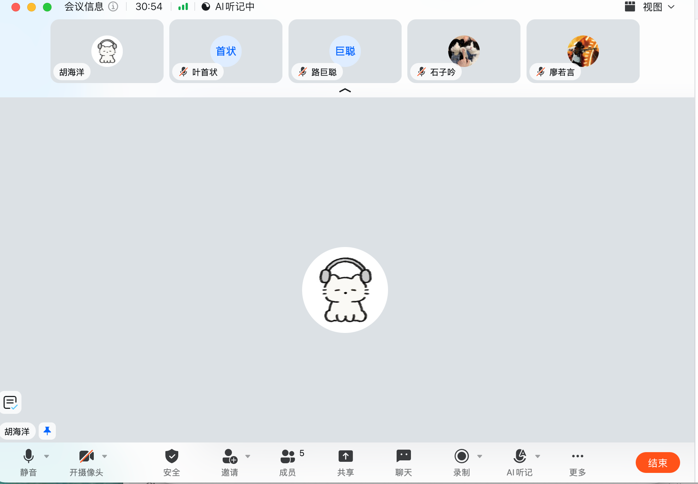
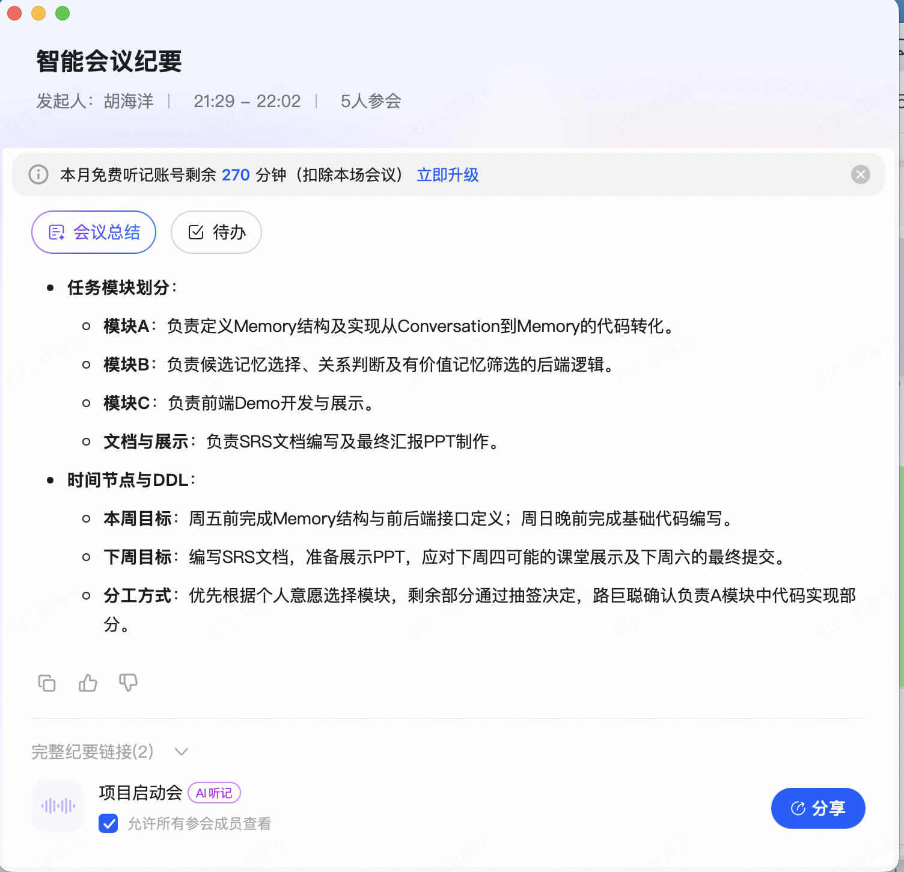

本次会议主要讨论了基于大语言模型的记忆处理系统开发流程，明确了从对话提取结构化记忆、动态关系判断及前端展示的技术路径，并完成了团队分工与近期里程碑的时间规划。

1. 技术架构与核心逻辑
记忆处理流程：

结构化提取：通过调用LLM将非结构化对话转化为结构化记忆（Memory），需自行定义记忆结构。
动态状态判断：利用LLM判断新信息与旧信息的四种关系（无冲突、更新且保留、更新且覆盖、冲突），例如“工作室计划阶段”到“正式开业”属于状态更替（S开头关系）。
价值筛选与生成：从候选记忆中筛选出最有价值的记忆（如失业事件、开业时间），结合问题生成最终答案及证据链。
前后端交互设计：

后端职责：接收前端问题与记忆库，执行候选记忆选择、关系梳理及有价值记忆筛选，返回结果。
前端职责：展示用户提问、系统返回的结果以及记忆间的关联关系。
接口规范：重点统一B模块（后端逻辑）与C模块（前端）之间的输入输出格式，以后端接口定义为主导。
2. 数据结构与规范定义
Memory结构设计：

字段定义：需明确Memory ID、内容、可信度（指从证据推导结论的可信度）、来源等字段含义。
粒度控制：建议以单次对话为单位建立记忆库，而非单句话，以优化AI处理性能和维护性。
可追溯性：暂不强制要求返回具体对应句子，作为可选的Bonus功能后续考虑。
仓库与文档管理：

代码结构：后端包含A（记忆提取）和B（逻辑处理）部分，前端独立；保留Proposal、SRS文档及课程相关资料。
测试数据：使用提供的示例数据（如张开练武式例子）进行演示和测试。
3. 项目分工与进度安排
任务模块划分：

模块A：负责定义Memory结构及实现从Conversation到Memory的代码转化。
模块B：负责候选记忆选择、关系判断及有价值记忆筛选的后端逻辑。
模块C：负责前端Demo开发与展示。
文档与展示：负责SRS文档编写及最终汇报PPT制作。
时间节点与DDL：

本周目标：周五前完成Memory结构与前后端接口定义；周日晚前完成基础代码编写。
下周目标：编写SRS文档，准备展示PPT，应对下周四可能的课堂展示及下周六的最终提交。
分工方式：优先根据个人意愿选择模块，剩余部分通过抽签决定，路巨聪确认负责A模块中代码实现部分。