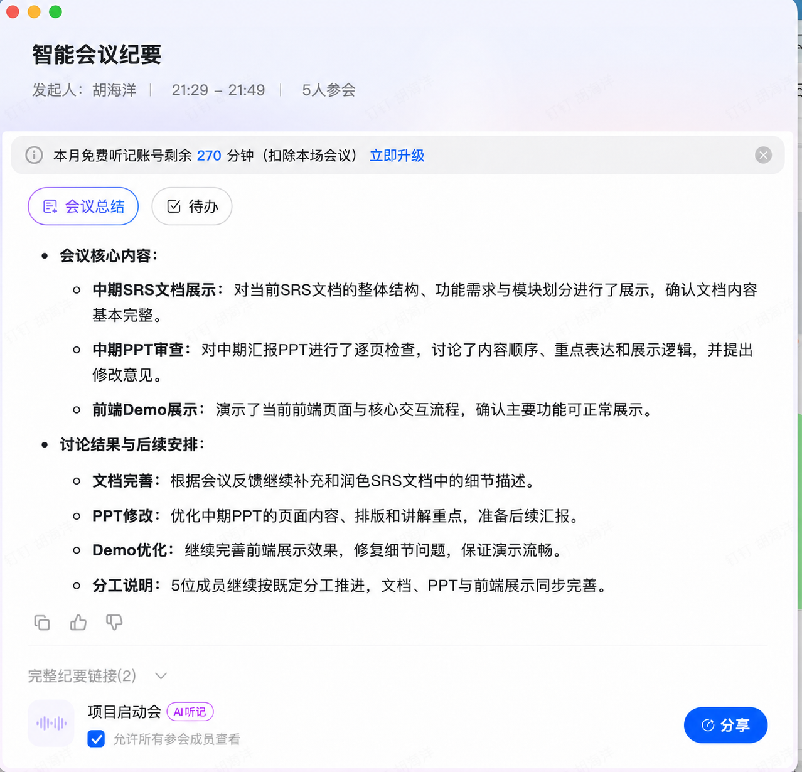

# 10 月 20 日第三次会议纪要

## 会议基本信息

- 时间：2026 年 10 月 20 日 21:29—21:49
- 发起人：胡海洋
- 参会人数：5 人
- 会议形式：线上会议
- 会议主题：中期 SRS、汇报 PPT 与前端 Demo 审查

## 会议目标

在中期展示前集中检查 SRS 文档、汇报 PPT 和前端 Demo 的完成情况，统一展示内容与讲解逻辑，并明确会后的修改任务。会议确认三项材料均已具备基本框架，后续重点转为细节补充、表达优化和演示稳定性检查。

## 讨论内容

### 1 SRS 文档展示

会议展示了当前 SRS 文档的整体结构、功能需求和模块划分。现有内容已覆盖系统的主要组成部分，能够说明从结构化 Memory 构建、候选记忆检索、动态状态解析到前端展示的完整链路。与会成员认为文档主体基本完整，仍需根据审查意见补充细节描述，并检查需求、接口和实际实现之间的一致性。

### 2 中期 PPT 审查

会议逐页检查了中期汇报 PPT，重点讨论内容顺序、核心信息表达和现场展示逻辑。PPT 应围绕项目问题、系统方案、模块实现、当前成果和 Demo 展开，突出动态记忆的检索、状态关系判断、有效记忆选择及证据回链。会后继续调整页面内容和排版，并明确每页的讲解重点。

### 3 前端 Demo 展示

会议演示了当前前端页面和主要交互流程，确认核心功能可以正常展示。中期演示需要稳定呈现问题输入、候选 Memory、关系判断、Effective Memory、最终答案和证据来源。后续继续修复界面与交互细节，并检查前后端联调、正式数据接入和现场启动流程。

## 会议结论

1. SRS、PPT 和 Demo 已具备中期展示基础，后续工作以完善和验收为主。
2. SRS 继续补充需求细节，并统一需求描述、接口契约和当前实现。
3. 中期 PPT 继续优化内容顺序、页面排版和讲解重点，保证汇报逻辑连贯。
4. Demo 继续完善展示效果和细节问题，并通过端到端检查保证现场演示流畅。
5. 五名成员继续按照既定分工推进，文档、PPT 与 Demo 三条工作线同步收尾。

## 后续安排

| 工作项 | 后续任务 | 验收目标 |
| --- | --- | --- |
| SRS | 根据会议反馈补充和润色细节，复核需求编号、接口与实现的一致性 | 文档内容完整，可用于中期提交与展示 |
| PPT | 调整页面内容、排版和讲解顺序，统一重点表达 | 形成可直接汇报的中期版本 |
| Demo | 修复展示细节，复核前后端联调、数据和启动流程 | 核心流程可稳定运行，现场演示顺畅 |
| 全组审核 | 对文档、PPT、Demo 进行最终一致性检查 | 三项材料对系统范围、术语和完成情况的表述一致 |
