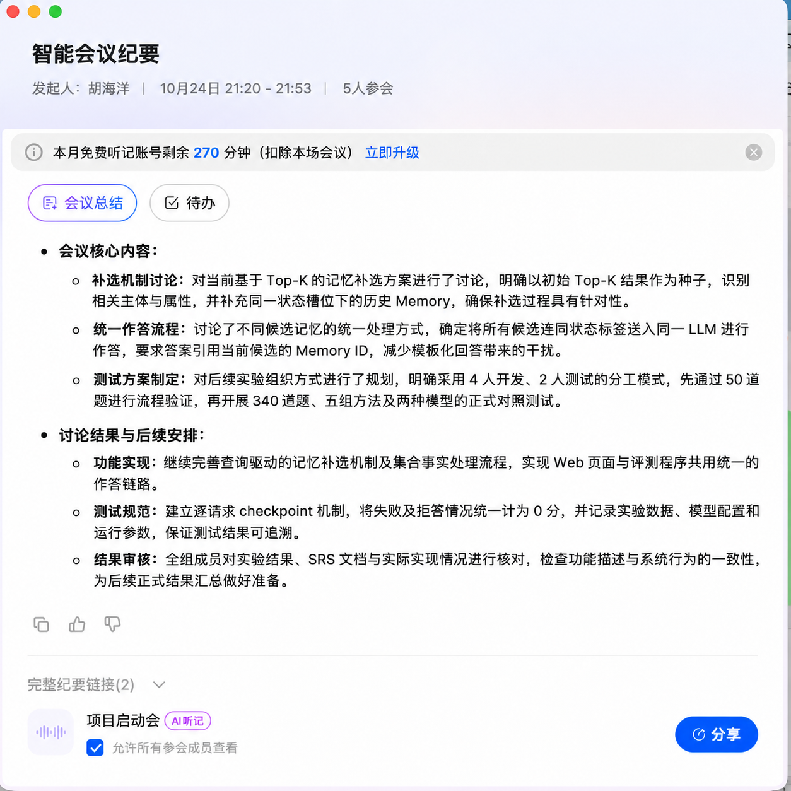

# 10 月 24 日第四次会议纪要

## 会议基本信息

- 时间：2026 年 10 月 24 日
- 会议形式：线上会议
- 会议主题：中期后第一阶段任务——补选实现与测试组织

## 会议目标

中期展示暴露出的核心问题是：固定 Top-K 只保证候选与问题“相关”，不能保证同一主体、同一属性的完整状态历史进入候选集，而状态解析只能处理已召回的 Memory。本次会议确定中期后第一阶段的工作：把 SRS 中 S 级的“局部状态历史扩展”落地为“筛选后再补选”的完整链路，并建立可复现、可对照的测试体系。

## 讨论内容

### 1 补选机制（查询驱动证据补检）

以初始 Top-K 为种子识别主体与属性，补全同一状态槽位的历史 Memory，再重建局部状态链；超出预算、无可用种子或缺少时间锚点时保守停止。集合类事实（如喜爱的活动）不机械按新旧互斥，时间类问题优先依据带日期的事件作答。

### 2 统一作答链路

检索、补检后的全部候选连同状态标签一起送入同一个 LLM 作答，规则选出的 Effective Memory 只作提示；答案必须引用当前候选中的 Memory ID，证据不足返回 null，不再使用模板答案。Web 与评测共享同一条链路。

### 3 测试组织

- 数据划分：自定 4 个开发样本（conv-41/42/43/44）与 2 个测试样本（conv-47/48），冻结 6 个样本的 Memory 并记录哈希。
- 先导：先用 50 题跑通统一问答对照与 Memory 校验，确认流程无误后再扩大规模。
- 正式对照：340 道测试题，比较 Full Text、Embedding K5、Hybrid K5、K5 + 补检、Hybrid K10 五组方法，使用两个可用模型；逐请求 checkpoint，失败与拒答计 0 分。
- 指标：答案 F1 / EM、Memory 证据召回、候选数、输入 Token、拒答与错误。

## 会议结论

1. 中期后的主线确定为“初始检索后补选”，先实现查询驱动同槽位补检。
2. 所有方法统一由真实 LLM 作答并校验引用，去除模板答案兜底。
3. 测试按“自定划分 → 冻结 Memory → 50 题先导 → 340 题正式对照”的顺序推进，数据与配置全程留存哈希。
4. 结论只依据同一配置下的对照，不宣称未经验证的提升。

## 后续安排

| 工作项 | 后续任务 | 验收目标 |
| --- | --- | --- |
| 补选实现 | 完成查询驱动补检与集合事实处理 | 专项用例能找回 Top-K 遗漏的同槽位历史 |
| 统一作答 | 候选连同状态标签送入 LLM，引用 ID 严格校验 | Web 与评测共用链路，无模板兜底 |
| 测试组织 | 冻结 Memory，完成 50 题先导与 340 题五组两模型对照 | 结果可复现，生成轻量提交结果包 |
| 全组审核 | 核对结果、文档与实现一致 | 形成第一版正式结果 |
