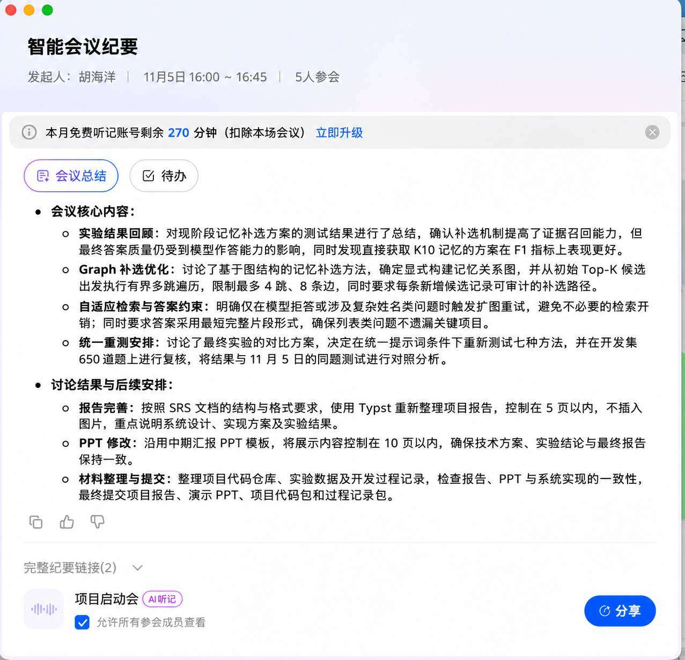

# 第五次会议纪要

## 会议基本信息

- 时间：2026 年 11 月 5 日
- 会议形式：线上会议
- 会议主题：中期后第二阶段——Graph Memory 自适应补选、统一重测与最终材料

## 会议目标

回顾 11 月 5 日第一版正式结果：补检提高了证据召回（约 59.9% → 65.0%），但答案 F1 的收益依赖模型，且直接取 K10 的 F1 更高。本次会议确定第二阶段工作：把补选扩展为显式建图的多跳补选并改为按需触发，改进答案约束，在统一配置下重测全部方法，并完成最终报告、PPT 与提交材料。

## 讨论内容

### 1 Graph Memory 多跳补选

只依据结构化 Memory 及来源字段建图（memory、subject、slot、value、session、turn 六类节点），沿 NEXT_STATE、NEXT_TURN 等边从 Top-K 出发做有界遍历（最多 4 跳、新增 8 条），按路径强度与问题相关性排序，并以主体范围、主题过滤阻止无关连边；每条新增候选返回可审计路径。

### 2 自适应补选与答案约束

一律扩图会给简单题带来干扰，因此改为先用 Top-K 作答，仅在拒答或复数姓名题时扩图重试。答案改为最短但完整的片段：保持所问粒度、列表不漏项，字符串 "null" 归一化为拒答。

### 3 统一重测与结果整合

旧提示词与新提示词的结果不能直接相减。会议决定在最终提示词下重测测试集全部七种方法（Full Text、Embedding K5、Hybrid K5、K5 + 补检、Hybrid K10、Forced Graph、Adaptive Graph），并在开发集 650 题上复核 Graph 三组；与 11 月 5 日结果合并为同题配对的版本对照，报告置信区间、提升与下降题数。

### 4 最终材料与仓库整理

最终报告按 SRS 版式重写（Typst，≤ 5 页，不放图片），PPT 沿用中期模板（≤ 10 页，图片放在 PPT 中）；历史结果与过程文档归档而不删除；提供一键重测、结果整合与提交打包脚本，以及 `--final` 最终版 Demo 启动方式。

## 会议结论

1. 最终补选方案为 Graph Memory 自适应补选，查询驱动补检保留为对照。
2. 统一提示词下重测并做开发集复核；结论以同版本配对比较为准，如实报告 K10 与 Full Text 的表现。
3. 最终提交四项材料：最终报告、最终展示 PPT、可运行项目代码压缩包、过程记录压缩包。

## 会后进展（11 月 9 日）

按会议安排完成统一重测与结果整合：补选相对 K5 稳定提升 2–3 个百分点，开发集复核成立；自适应补选在测试集与开发集上均无下降题；K10 精度略高但上下文更多，Full Text 为精度上限；答案约束使各方法再提升 6–8 个百分点。详见 [合并实验结果](../../docs/results/results-v1-v2.md)。

## 后续安排

| 工作项 | 后续任务 | 验收目标 |
| --- | --- | --- |
| Graph 补选 | 完成建图、遍历、自适应重试与前端路径展示 | 测试、构建与 API 验收全部通过 |
| 统一重测 | 测试集七种方法 + 开发集三组，合并 11 月 5 日结果 | 结果入库，配对比较与置信区间可复算 |
| 最终报告 | 按 SRS 版式重写并编译 PDF | 不超过 5 页，数字与结果一致 |
| 最终 PPT | 沿用中期模板更新内容 | 不超过 10 页，与报告口径一致 |
| 提交打包 | 整理仓库、补全过程记录、生成四项提交物 | 代码可按 README 启动，材料完整 |
